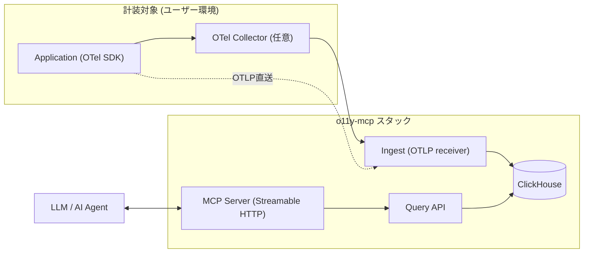

# o11y-mcp

最小構成で OpenTelemetry (OTel) のテレメトリを収集・保存・参照し、Model Context Protocol (MCP) 経由で LLM / AI エージェントから活用できる、個人開発・小規模チーム向けの Observability (o11y) OSS ツールです。

[English README](./README.en.md)

> **現在のステータス**: Ingest / Query API / MCP Server の実装と Docker Compose での動作確認、Azure Bicep (`az deployment sub what-if` による検証まで) が完了しています。実際の `azd up` によるデプロイ確認とOSS運用資材(CONTRIBUTING等)はこれからです。詳細は [`docs/requirements.md`](./docs/requirements.md) / [`docs/design.md`](./docs/design.md) を参照してください。

## 特徴

- OTLP (HTTP/gRPC) でのテレメトリ受信 (Traces / Metrics / Logs)
- ClickHouse による低コスト・高圧縮な列指向ストレージ (Hot/Cold Tiered Storage)
- REST な Query API と、MCP (Streamable HTTP) 経由でのテレメトリ参照
- Docker Compose (一次ターゲット) / Azure Container Apps + Bicep (推奨本番) の両対応
- 日本国内リージョン (Japan East 既定) に閉じた構成
- 依存パッケージ・上流仕様 (OTel/MCP) の変化を自動検知するメンテナンス監視パイプライン

## アーキテクチャ



詳細な構成図は [`docs/architecture.drawio`](./docs/architecture.drawio) ([draw.io](https://app.diagrams.net) で開く) を参照してください。

## セットアップ

```bash
git clone <このリポジトリ>
cd o11y-mcp/deploy/compose
cp .env.example .env  # API Key 等を必ず変更してください
docker compose up -d --build
```

起動後の主なエンドポイント:

| コンポーネント | URL | 認証 |
| :--- | :--- | :--- |
| Ingest (OTLP/HTTP) | `http://localhost:4318/v1/{logs,traces,metrics}` | なし |
| Ingest (OTLP/gRPC) | `localhost:4317` | なし |
| Query API | `http://localhost:8080/v1/...` | `Authorization: Bearer <QUERY_API_KEY>` |
| MCP Server (Streamable HTTP) | `http://localhost:8081/` | `Authorization: Bearer <MCP_API_KEY>` |
| Grafana | `http://localhost:3000` (admin / `.env`の`GRAFANA_ADMIN_PASSWORD`) | - |
| MinIO コンソール | `http://localhost:9001` | `.env`の`MINIO_ROOT_USER`/`PASSWORD` |

停止・破棄 (FR-OP-04):

```bash
docker compose down -v
```

Azure へのデプロイ (Bicep は用意済み。`azd up` での実デプロイはまだ実施していません):

```bash
azd auth login
azd up
```

`infra/azure/` の詳細 (モジュール構成・既知の制約) は [`docs/design.md`](./docs/design.md) §9 を参照してください。
デプロイ前に構文・整合性だけ確認したい場合:

```bash
az bicep build --file infra/azure/main.bicep
az deployment sub what-if --location japaneast --template-file infra/azure/main.bicep \
  --parameters environmentName=<任意の名前> clickhousePassword=<パスワード> queryApiKey=<キー> mcpApiKey=<キー>
```

## ディレクトリ構成

```
o11y-mcp/
├── apps/
│   ├── ingest/   # OTLP受信 (OpenTelemetry Collector Builder による構成)
│   ├── query/    # Query API (Go, REST)
│   └── mcp/      # MCP Server (Go, Streamable HTTP)
├── infra/azure/  # Bicep (モジュール化) + Azure向けClickHouseカスタムイメージ
├── deploy/compose/ # Docker Compose 定義
├── azure.yaml     # azd プロジェクト定義
├── docs/          # 要件定義書・設計書・構成図
└── .github/       # CI / リリース自動化 / 依存・上流監視ワークフロー (未整備)
```

## 技術スタック

Go / OpenTelemetry Collector Builder / ClickHouse / MCP 公式 Go SDK / Docker Compose / Azure Container Apps / Bicep + azd。
選定理由は [`docs/design.md`](./docs/design.md) を参照してください。

## ドキュメント

- [要件定義書](./docs/requirements.md)
- [設計書](./docs/design.md)
- [構成図 (draw.io)](./docs/architecture.drawio)

## ライセンス

[Apache License 2.0](./LICENSE)

## コントリビュート

[`CONTRIBUTING.md`](./CONTRIBUTING.md) を参照してください。バグ報告・機能要望は
[Issueテンプレート](.github/ISSUE_TEMPLATE/) から、セキュリティ報告は [`SECURITY.md`](./SECURITY.md) の
手順に従ってください。行動規範は [`CODE_OF_CONDUCT.md`](./CODE_OF_CONDUCT.md) を参照してください。

## 既知の制約 / TODO

- Azure は Bicep 作成・`what-if`検証まで完了。実際の `azd up` によるデプロイ確認はこれから ([`docs/design.md`](./docs/design.md) §9 参照)
- Azure版はOTLP/gRPC未対応 (Container Apps Consumptionプランの制約、§9.4参照)、Azure版のTTL/storage_policy migrationも手動適用が必要
- Entra ID 認証は v1.0 のスコープ外 (v1.1以降で再検討)
- ダッシュボード UI は自作せず Grafana + ClickHouse datasource で代替
- CI/リリース/依存監視ワークフロー (`.github/workflows/`) はファイル作成済みだが、リモートリポジトリへのpush・実行確認はまだ行っていない
