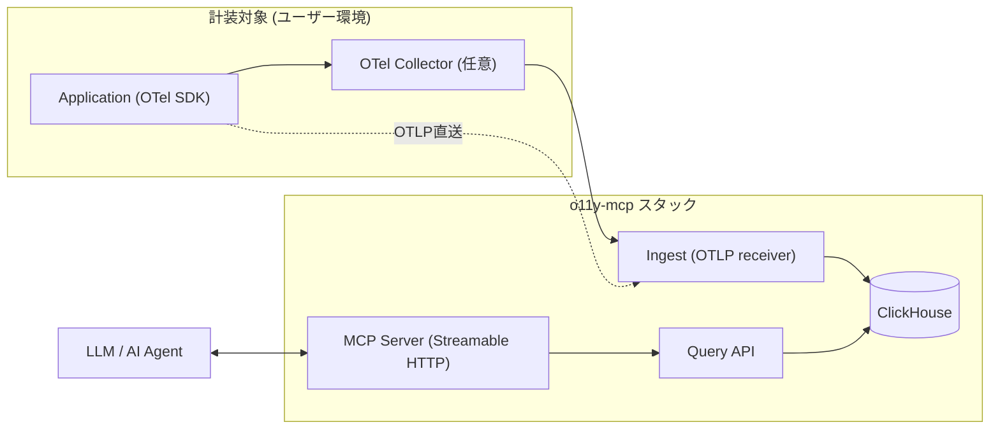

# o11y-mcp

最小構成で OpenTelemetry (OTel) のテレメトリを収集・保存・参照し、Model Context Protocol (MCP) 経由で LLM / AI エージェントから活用できる、個人開発・小規模チーム向けの Observability (o11y) OSS ツールです。

[English README](./README.en.md)

> **現在のステータス**: 要件定義・設計フェーズ完了、実装着手前のスキャフォールド段階です。詳細は [`docs/requirements.md`](./docs/requirements.md) / [`docs/design.md`](./docs/design.md) を参照してください。

## 特徴

- OTLP (HTTP/gRPC) でのテレメトリ受信 (Traces / Metrics / Logs)
- ClickHouse による低コスト・高圧縮な列指向ストレージ (Hot/Cold Tiered Storage)
- REST な Query API と、MCP (Streamable HTTP) 経由でのテレメトリ参照
- Docker Compose (一次ターゲット) / Azure Container Apps + Bicep (推奨本番) の両対応
- 日本国内リージョン (Japan East 既定) に閉じた構成
- 依存パッケージ・上流仕様 (OTel/MCP) の変化を自動検知するメンテナンス監視パイプライン

## アーキテクチャ



詳細な構成図は [`docs/architecture.drawio`](./docs/architecture.drawio) ([draw.io](https://app.diagrams.net) で開く) を参照してください。

## セットアップ (予定 / 実装後に有効)

```bash
git clone <このリポジトリ>
cd o11y-mcp
cp deploy/compose/.env.example deploy/compose/.env  # API Key 等を設定
docker compose -f deploy/compose/docker-compose.yml up
```

Azure へのデプロイ (予定):

```bash
azd auth login
azd up
```

## ディレクトリ構成

```
o11y-mcp/
├── apps/
│   ├── ingest/   # OTLP受信 (OpenTelemetry Collector Builder による構成)
│   ├── query/    # Query API (Go, REST)
│   └── mcp/      # MCP Server (Go, Streamable HTTP)
├── infra/azure/  # Bicep (モジュール化)
├── deploy/compose/ # Docker Compose 定義
├── docs/          # 要件定義書・設計書・構成図
└── .github/       # CI / リリース自動化 / 依存・上流監視ワークフロー
```

## 技術スタック

Go / OpenTelemetry Collector Builder / ClickHouse / MCP 公式 Go SDK / Docker Compose / Azure Container Apps / Bicep + azd。
選定理由は [`docs/design.md`](./docs/design.md) を参照してください。

## ドキュメント

- [要件定義書](./docs/requirements.md)
- [設計書](./docs/design.md)
- [構成図 (draw.io)](./docs/architecture.drawio)

## ライセンス

[Apache License 2.0](./LICENSE)

## コントリビュート

準備中です ([`CONTRIBUTING.md`](./CONTRIBUTING.md) を今後整備します)。

## 既知の制約 / TODO

- 実装未着手 (Query API から着手予定、[`docs/design.md`](./docs/design.md) §8 参照)
- Entra ID 認証は v1.0 のスコープ外 (v1.1以降で再検討)
- ダッシュボード UI は自作せず Grafana + ClickHouse datasource で代替
