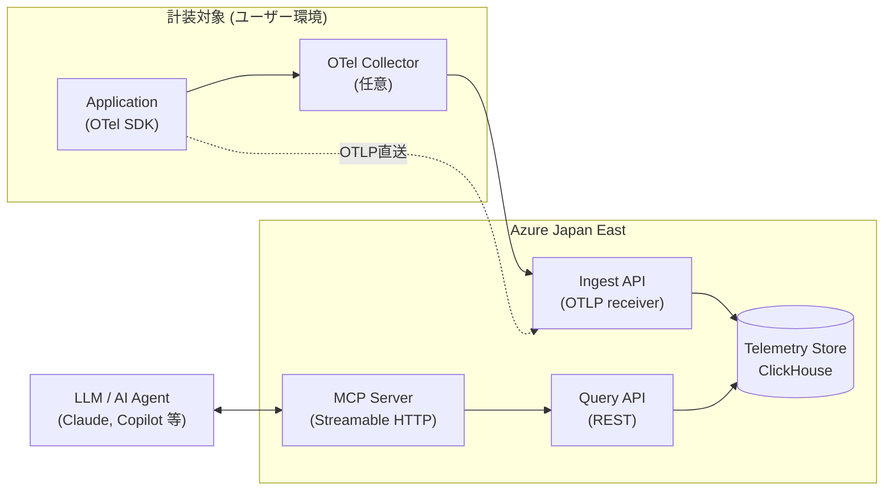

# 要件定義書：o11y-mcp (最小構成 Observability OSS ツール)

| 項目 | 内容 |
| :--- | :--- |
| ドキュメント名 | 要件定義書 (Requirements Specification) |
| プロジェクト名 | **o11y-mcp** |
| バージョン | 1.0 (Confirmed) |
| 作成日 | 2026-07-08 |
| 確定日 | 2026-07-15 |
| 作成者 | Nakagawa Yuki |
| ステータス | 確定 (v1.0) — 対話ヒアリングにより Draft 0.1 の未確定事項を解消済み |

> 本書は 2026-07-08 付ドラフト (v0.1) を元に、personal-dev-agent との対話ヒアリングで残っていた未確定事項を確定させたものです。ドラフトからの変更点は各節に *(確定)* として明記しています。

---

## 1. はじめに

### 1.1 本書の目的
本書は、OpenTelemetry (以下 OTel) で収集したテレメトリデータを蓄積・参照し、Model Context Protocol (以下 MCP) を通じて LLM / エージェントから活用可能とする、最小構成の Observability (以下 o11y) OSS ツール **o11y-mcp** の要件を明確化することを目的とする。

### 1.2 用語定義
| 用語 | 説明 |
| :--- | :--- |
| OTel | OpenTelemetry。CNCF プロジェクトのテレメトリ (Metrics / Logs / Traces) 収集標準。 |
| OTLP | OpenTelemetry Protocol。OTel 標準の転送プロトコル (gRPC / HTTP)。 |
| o11y | Observability (可観測性)。 |
| MCP | Model Context Protocol。LLM / AI エージェントに外部データ・ツールを公開するプロトコル。 |
| Collector | OpenTelemetry Collector。テレメトリの受信・加工・転送を行うエージェント。 |

### 1.3 想定読者
- プロジェクトオーナー / 意思決定者
- 開発メンバー
- OSS コミュニティのコントリビュータ候補
- Azure インフラ設計・レビュア

---

## 2. プロジェクト背景と目的

### 2.1 背景
- 商用 APM / o11y SaaS はスケールに応じてコストが急増する。
- 小規模チーム・個人開発者・PoC 用途では「必要最小限で安価に、しかも AI/LLM と連携できる」o11y 基盤が求められている。
- OTel が事実上の標準となり、SDK / Collector を再利用できる土台が整った。
- MCP の登場により、テレメトリを LLM の一次情報として扱う道が開けた。

### 2.2 目的
1. **最小構成** で OTel データを収集・保存・参照できる o11y スタックを OSS として提供する。
2. **Azure** のマネージドサービスを最大限活用し、運用工数を最小化する。
3. **MCP サーバ** を同梱し、収集済みデータを AI エージェントから自然言語で扱えるようにする。
4. **日本国内リージョン** で完結する構成とし、データ所在地要件に応える。
5. **OSS としての運用負荷を最小化する** *(確定/追加)*: コントリビュータのオンボーディングとリリース作業を仕組み化し、メンテナンスの要否を自動検知するパイプラインを備える。

### 2.3 スコープ
| 区分 | 内容 |
| :--- | :--- |
| In Scope | OTLP 受信 API、テレメトリ保存 (ClickHouse)、参照 API、MCP サーバ、**Docker Compose デプロイ資材**、**Azure 向け Bicep (モジュール化)**、OSS 公開一式 (README / LICENSE / CI 等)、**コントリビュータ向けオンボーディング**、**リリース自動化**、**依存関係/上流仕様の監視パイプライン** |
| Out of Scope | 独自 SDK 開発、ダッシュボード UI 自作 (Grafana 連携で代替 *(確定)*)、アラート / インシデント管理、マルチテナント認可基盤、Kubernetes / Helm、Entra ID 認証 (v1.0では対象外 *(確定)*、v1.1以降で再検討) |

### 2.4 デプロイターゲット方針
本 OSS は **「Docker を基調とし、Azure PaaS はホスト先の一形態」** として設計する。同一の OCI イメージを全ターゲットで共有する。

| ターゲット | 位置付け | 提供物 |
| :--- | :--- | :--- |
| **Docker Compose** (IaaS / オンプレ / 開発) | 一次ターゲット (Reference) | `deploy/compose/docker-compose.yml` |
| **Azure Container Apps + Blob** (推奨本番) | 二次ターゲット (Managed / Scale-to-Zero) | `infra/azure/*.bicep` (モジュール化) + `azure.yaml` (azd) |

---

## 3. システム全体像

### 3.1 コンポーネント構成 (論理)

詳細な構成図 (draw.io 形式) は [`docs/architecture.drawio`](./architecture.drawio) を参照 (draw.io / https://app.diagrams.net で開く)。

### 3.2 主要ユースケース
| ID | ユースケース | アクター |
| :--- | :--- | :--- |
| UC-01 | アプリから OTLP でテレメトリを送信する | 計装対象アプリ / Collector |
| UC-02 | 蓄積されたテレメトリを REST API で取得する | 開発者 / 外部システム |
| UC-03 | LLM / エージェントが MCP 経由でテレメトリを問い合わせる | AI エージェント |
| UC-04 | Bicep / azd で最小構成を日本リージョンにデプロイする | 導入者 |
| UC-05 | コントリビュータが OSS にコントリビュートする *(確定/追加)* | OSS コントリビュータ |
| UC-06 | 依存関係/上流仕様の変化を自動検知し保守対応を判断する *(確定/追加)* | プロジェクトメンテナ |

---

## 4. 機能要件

### 4.1 データ収集 API (Ingest API)
| ID | 要件 | 優先度 |
| :--- | :--- | :--- |
| FR-IN-01 | OTLP/HTTP (protobuf) の受信をサポートする | Must |
| FR-IN-02 | OTLP/gRPC の受信をサポートする | Should |
| FR-IN-03 | Traces / Metrics / Logs の 3 シグナルを受け付ける | Must |
| FR-IN-04 | 受信データをストレージに永続化する (非同期可) | Must |
| FR-IN-05 | 認証トークン (API Key) による受信制御を行う *(確定: API Keyのみ)* | Must |
| FR-IN-06 | サイズ超過・不正リクエストは 4xx で拒否し、内部エラーは 5xx で応答する | Must |
| FR-IN-07 | 受信件数 / 失敗件数を自己 o11y メトリクスとして出力する | Should |

### 4.2 データ保存 (Telemetry Store)
> **確定方針**: 実装は **ClickHouse** (Apache-2.0) とする。

| ID | 要件 | 優先度 |
| :--- | :--- | :--- |
| FR-ST-01 | Traces / Metrics / Logs をすべて ClickHouse の専用テーブルに保存する | Must |
| FR-ST-02 | 列指向 + 高圧縮 (LZ4 / ZSTD) により生ログ比 **1/5 〜 1/10** のディスク占有量とする | Must |
| FR-ST-03 | ClickHouse の Tiered Storage (`azure_blob_storage` / `s3` disk) により **ホット (SSD) → コールド (オブジェクトストレージ)** に自動移送できること | Must |
| FR-ST-04 | 保存期間と移送しきい値を **TTL SQL で変更可能** (既定: ホット 7日 / コールド 30日 / 削除) | Must |
| FR-ST-05 | **後から容量拡張可能** (ホット: PV/ボリューム拡張 / コールド: Blob は実質無制限) | Must |
| FR-ST-06 | コスト目標: Log Analytics (Analytics Logs) の **1/5 以下**、New Relic Standard の **1/2 以下** (GB 単価) | Must |
| FR-ST-07 | 日本国内リージョン (Japan East / West、LRS 既定) 内に保存することを保証する | Must |
| FR-ST-08 | スキーマは OTel データモデル (resource / scope / attributes / body / span 等) を保持する | Must |
| FR-ST-09 | Trace ID / Service 名 / 時刻範囲 / 属性で検索できる | Must |

### 4.3 参照 API (Query API)
| ID | 要件 | 優先度 |
| :--- | :--- | :--- |
| FR-QR-01 | 期間・サービス名・重大度などの条件でログを検索できる | Must |
| FR-QR-02 | Trace ID からトレース全体 (spans) を取得できる | Must |
| FR-QR-03 | メトリクスを時系列で取得できる (集計関数指定可) | Should |
| FR-QR-04 | 応答は JSON。ページングを備える | Must |
| FR-QR-05 | 認証 (API Key) を要求する *(確定: v1.0はAPI Keyのみ、Entra IDはOut of Scope)* | Must |

### 4.4 MCP サーバ
| ID | 要件 | 優先度 |
| :--- | :--- | :--- |
| FR-MC-01 | MCP 仕様 (最新の安定版) に準拠する | Must |
| FR-MC-02 | 以下のツール (tools) を提供する: `search_logs`, `get_trace`, `list_services`, `query_metrics` | Must |
| FR-MC-03 | 内部で Query API を呼び出しデータを取得する | Must |
| FR-MC-04 | **Streamable HTTP を主トランスポートとしてサポートする** *(確定)*。stdio は将来対応候補 (Could) とする | Must |
| FR-MC-05 | 応答は LLM が扱いやすい要約可能なサイズにトリム / ページング可能 | Should |
| FR-MC-06 | Claude Desktop / VS Code (GitHub Copilot) から接続確認済みであること | Should |

### 4.5 デプロイ / 運用機能
| ID | 要件 | 優先度 |
| :--- | :--- | :--- |
| FR-OP-01 | **`docker compose up` 一発**で全コンポーネントが起動すること (一次デプロイ手段) | Must |
| FR-OP-02 | Azure Developer CLI (**`azd up`**) 一発で日本リージョンに構築できる | Must |
| FR-OP-03 | Bicep は **モジュール化**され、役割 (ネットワーク / ストレージ / Container Apps / セキュリティ等) ごとに分割して提供する | Must |
| FR-OP-04 | 破棄 (`azd down` / `docker compose down -v`) でリソースがクリーンに削除できる | Must |
| FR-OP-05 | すべてのコンポーネントは **同一の OCI イメージ** を Azure / IaaS で共有する | Must |
| FR-OP-06 | 環境変数 (`CLICKHOUSE_DSN`, `OBJECT_STORE_URL`, `AUTH_MODE` 等) で挙動を切替する | Must |
| FR-OP-07 | GitHub Actions で CI (lint / test / build / image push to GHCR) を実行する | Must |

### 4.6 OSS 運用支援 *(確定/追加: 「OSSの運用をできるだけ楽にしたい」への対応)*
| ID | 要件 | 優先度 |
| :--- | :--- | :--- |
| FR-OSS-01 | コントリビュータ向けオンボーディングを整備する。Issue / PR テンプレート、`CONTRIBUTING.md`、ローカル開発環境のセットアップ手順を用意する | Must |
| FR-OSS-02 | リリース作業を自動化する。タグ push を契機に SemVer に基づくバージョニング・CHANGELOG 生成・コンテナイメージの GHCR push を CI で完結させる | Must |

### 4.7 メンテナンス監視パイプライン *(確定/追加: 「メンテナンスの必要有無を監視したい」への対応)*
| ID | 要件 | 優先度 |
| :--- | :--- | :--- |
| FR-MON-01 | 依存パッケージの脆弱性 / 更新を自動検知し、必要に応じて自動で更新 PR を起票する仕組みを備える (Dependabot もしくは Renovate) | Must |
| FR-MON-02 | OTel Protocol / MCP 仕様の上流バージョンを定期的 (週次を既定) に確認し、破壊的変更・非推奨化を検知した場合に GitHub Issue を自動起票する仕組みを備える | Should |

---

## 5. 非機能要件

### 5.1 性能 / 規模
| ID | 要件 | 目標値 (初期) |
| :--- | :--- | :--- |
| NFR-P-01 | 受信スループット | 100 spans/sec, 1,000 log records/sec |
| NFR-P-02 | 参照 API 応答時間 (P95) | 2 秒以内 (期間 24h 検索時) |
| NFR-P-03 | MCP ツール応答時間 (P95) | 3 秒以内 |
| NFR-P-04 | 想定同時利用者 | 10 名程度 (小規模チーム前提) |

### 5.2 可用性
- SLA は掲げず、Best-effort とする (OSS のリファレンス実装として位置付け)。
- ただし単一障害点を避け、Azure マネージドサービスの標準冗長性 (Zone-redundant があれば利用) を活かす。

### 5.3 セキュリティ
| ID | 要件 |
| :--- | :--- |
| NFR-S-01 | すべての通信を HTTPS / TLS で保護する |
| NFR-S-02 | 認証は **API Key のみ** とする *(確定: v1.0)*。Entra ID 連携は Out of Scope (v1.1以降で再検討) |
| NFR-S-03 | シークレットは Azure Key Vault で管理し、コードに埋め込まない |
| NFR-S-04 | OWASP Top 10 に該当する脆弱性 (Injection / SSRF / 認可欠陥 等) を混入させない |
| NFR-S-05 | 監査ログ (受信・参照アクセス) を残す |
| NFR-S-06 | ストレージは保存時暗号化 (Microsoft-managed key で可) |

### 5.4 コスト
| ID | 要件 |
| :--- | :--- |
| NFR-C-01 | 無償枠 / 従量課金の低廉なサービスを優先し、常時起動のリソース最小化 (Serverless 優先) |
| NFR-C-02 | 保存データはコールドストレージ / 圧縮など、GB 単価が最小の方式を第一候補とする |
| NFR-C-03 | 想定コスト目安: **月額 5,000 円以下** *(確定)* (小規模 PoC 前提)。Cost Management で可視化可能とする |

### 5.5 可搬性 / 保守性
- ランタイム: コンテナ化 (Linux amd64/arm64) を必須とする。
- コード / IaC は日本語 README + 英語 README (最低限) を用意し、国際的コントリビュートも受け入れ可能とする。
- ロギングは構造化 (JSON) を既定とする。

### 5.6 データ所在地 / 準拠
| ID | 要件 |
| :--- | :--- |
| NFR-L-01 | Azure リージョンは **Japan East (東日本)** を既定とし、Japan West を DR 選択肢として構成可能とする |
| NFR-L-02 | Cross-Region 転送 (Geo-Replication) は既定 OFF。有効化時はドキュメントで明示する |

---

## 6. 技術方針 (確定)

### 6.1 コンポーネントとサービス (Azure / IaaS 両対応)
| 論理コンポーネント | Azure 版 (Bicep) | IaaS 版 (Compose) | 選定観点 |
| :--- | :--- | :--- | :--- |
| Ingest | **Container Apps** に OTel Collector コンテナ | 同一イメージを compose で起動 | OTLP 受信、Scale-to-Zero |
| Query API / MCP Server | **Container Apps** | 同一イメージを compose で起動 | コンテナ配布の一貫性 |
| 保存 (Hot) | **ClickHouse on Container Apps** (Persistent Volume) | **ClickHouse on Docker** (named volume) | Apache-2.0、高圧縮、SQL |
| 保存 (Cold / Tier) | **Azure Blob Storage** (Cool/Cold) | **MinIO** / **S3** / **Blob (SAS)** | GB 単価最小、実質無制限 |
| シークレット | **Key Vault + Managed Identity** | `.env` / Docker secret | 環境に応じた機密管理 |
| 認証 | API Key のみ *(確定)* | API Key のみ | OSS 想定でシンプル |
| CI/CD | GitHub Actions | 同左 | OSS 前提 |
| IaC | **Bicep (モジュール化) + azd** | `docker-compose.yml` | それぞれのネイティブ形式 |
| 自己 o11y | Application Insights (Basic) | Prometheus + Grafana (同梱可) | 環境ごとの標準手法 |
| 依存監視 | Dependabot/Renovate + 週次 GitHub Actions | 同左 | FR-MON-01/02 |

### 6.2 コスト最小化戦略
- **Scale-to-Zero**: Container Apps Consumption プランでアイドル時 0 インスタンス。
- **保存階層**: Hot は最小、既定で短期 (7 日) 保持。長期は Blob (Cool/Archive) にエクスポート可能とする。
- **ログのサンプリング**: OTel Collector 側で Tail-based sampling を有効化可能とする。
- **無償枠優先**: App Insights Basic / GitHub Actions 無償枠を活用。

### 6.3 OSS 公開
- ライセンス: **Apache-2.0** *(確定)*。企業利用しやすく OTel エコシステアと整合。
- リポジトリ構成: `apps/ingest`, `apps/query`, `apps/mcp`, `infra/`, `deploy/compose/`, `docs/`, `.github/workflows`, `.github/ISSUE_TEMPLATE`
- 必須ドキュメント: `README.md` (JP/EN), `LICENSE`, `CONTRIBUTING.md`, `CODE_OF_CONDUCT.md`, `SECURITY.md`
- リリース: SemVer、GitHub Releases + コンテナイメージ (GHCR)、タグ push トリガーで自動化 (FR-OSS-02)

---

## 7. 制約条件・前提

| 区分 | 内容 |
| :--- | :--- |
| 制約 | Azure サービスを主として利用する (マルチクラウド対応は将来検討)。 |
| 制約 | 日本国内リージョンに閉じる (デフォルト設定)。 |
| 制約 | OSS として公開する前提のライセンス/依存関係とする (GPL 系ライブラリは避ける)。 |
| 前提 | 利用者は Azure サブスクリプションを保有している。 |
| 前提 | 利用者は OTel SDK / Collector を導入済み、または導入可能である。 |
| 前提 | MCP クライアント (Claude Desktop, VS Code 等) を用意できる。 |

---

## 8. リスクと対応方針

| ID | リスク | 影響 | 対応方針 |
| :--- | :--- | :--- | :--- |
| R-02 | MCP 仕様の破壊的変更 | MCP サーバ改修 | SDK の安定版を採用、FR-MON-02 の週次チェックで早期検知 |
| R-03 | Container Apps Cold Start による遅延 | UX 劣化 | 最小 min-replicas を選択可能に、キープアライブ手段を用意 |
| R-04 | 想定超過のトラフィックでコスト増 | 予算超過 | Quota / Rate Limit / Cost Alert を IaC に組み込み |
| R-05 | セキュリティインシデント (トークン漏洩等) | データ漏洩 | Key Vault、Managed Identity、監査ログを標準化 |
| R-06 | 依存パッケージの脆弱性放置 | セキュリティリスク | FR-MON-01 の自動検知 + FR-OSS-02 の迅速なリリースで対応 |

---

## 9. 成果物一覧

| # | 成果物 | 形式 |
| :--- | :--- | :--- |
| 1 | 要件定義書 (本書) | Markdown |
| 2 | 設計書 (アーキテクチャ / 利用サービス / 構成図) | Markdown + draw.io |
| 3 | ソースコード一式 | GitHub リポジトリ |
| 4 | IaC (Bicep + azd テンプレート) | GitHub リポジトリ |
| 5 | README (日本語 / 英語) | Markdown |
| 6 | CI / メンテナンス監視ワークフロー | GitHub Actions YAML |
| 7 | コンテナイメージ | GHCR (Ingest / Query / MCP) |

---

## 10. 確定事項サマリ (v1.0)

対話ヒアリングにより、ドラフト v0.1 の「未確定事項」はすべて以下の通り確定した。

| 項目 | 確定内容 |
| :--- | :--- |
| 認証方式 | API Key のみ (v1.0)。Entra ID は Out of Scope |
| MCP トランスポート | Streamable HTTP を主 |
| UI 提供 | Grafana + ClickHouse datasource で代替 (自作 UI なし) |
| ライセンス | Apache-2.0 |
| プロジェクト名 | o11y-mcp |
| 月額コスト目標 | 5,000 円以下 |
| OSS 運用の楽さ | コントリビュータオンボーディング整備 + リリース自動化 |
| メンテナンス監視 | 依存パッケージ脆弱性/更新検知 + OTel/MCP 仕様の破壊的変更追随チェック |

### 今後の軽微な検討事項 (実装中に判断)
- FR-MON-02 の通知先 (GitHub Issue 起票を既定とし、将来 Slack 等への拡張を可とするか)
- Dependabot vs Renovate のどちらを採用するか (設計書フェーズで選定)
